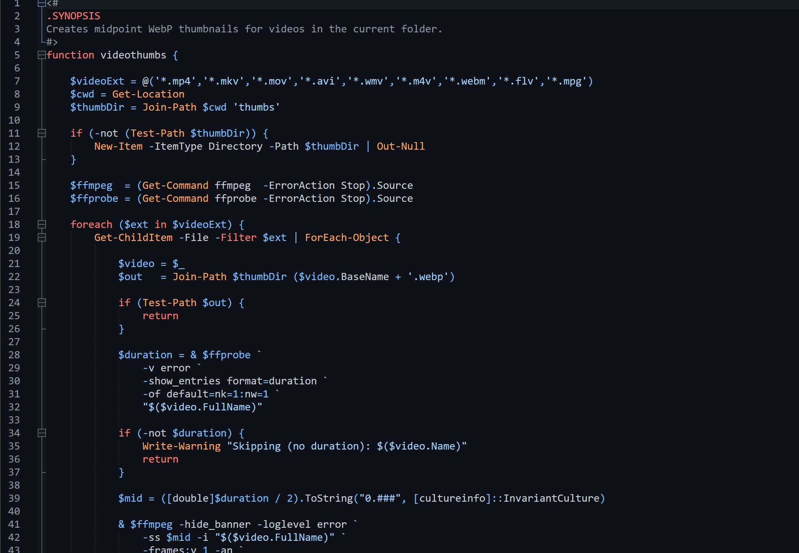

# GitHub Dark Theme for Notepad++

[](LICENSE)
[](https://notepad-plus-plus.org/)

A GitHub Dark-inspired color theme for Notepad++.

Built on Notepad++'s existing dark theme structure, it brings the colors of the [GitHub Dark theme for highlight.js](https://github.com/highlightjs/highlight.js/blob/main/src/styles/github-dark.css) to the Notepad++ editor, including syntax highlighting and editor interface elements.



## Highlights

- GitHub Dark-inspired syntax colors
- Styles for 92 language lexers
- Matching colors for selections, line numbers, indentation guides, and code folding
- Designed for comfortable reading during long editing sessions
- Tested with Notepad++ 8.9.8.1
- No plugin required

## Installation

1. Download [`GitHubDark.xml`](GitHubDark.xml).
2. Close Notepad++ if it is running.
3. Copy `GitHubDark.xml` into your `themes` folder:

   **Standard installation**

   ```text
   %AppData%\Notepad++\themes\
   ```

   **Portable installation**

   ```text
   <your Notepad++ folder>\themes\
   ```

4. Open Notepad++.
5. Go to **Settings → Style Configurator**.
6. Choose **GitHubDark** from the **Select theme** list.
7. Click **Save & Close**.

> [!TIP]
> For a consistent appearance, you can also enable the Notepad++ interface dark mode under **Settings → Preferences → Dark Mode**.

## Updating

Download the latest `GitHubDark.xml`, replace the existing file in your `themes` folder, and restart Notepad++.

## Troubleshooting

If the theme does not appear in **Style Configurator**:

- Check that the filename is `GitHubDark.xml`, not `GitHubDark.xml.txt`.
- Confirm that the file is in the correct `themes` folder.
- Restart Notepad++ after copying the file.

## Customization

You can adjust colors and fonts using **Settings → Style Configurator**. Keep a backup of your modified XML before updating, as replacing the theme file will overwrite your changes.

## Credits

This theme brings together existing open-source work:

- **[Notepad++](https://github.com/notepad-plus-plus/notepad-plus-plus):** The theme is adapted from [`DarkModeDefault.xml`](https://github.com/notepad-plus-plus/notepad-plus-plus/blob/master/PowerEditor/installer/themes/DarkModeDefault.xml), itself derived from Zenburn. The upstream theme file identifies its license as GPL-2.
- **[highlight.js](https://github.com/highlightjs/highlight.js):** The color palette is based on [`github-dark.css`](https://github.com/highlightjs/highlight.js/blob/main/src/styles/github-dark.css), maintained by @Hirse and distributed as part of the BSD-3-Clause-licensed highlight.js project.

Adapted and maintained for Notepad++ by **Tom Papatolis** (2026).

## License

`GitHubDark.xml` is a modified version of the GPL-2-licensed Notepad++ `DarkModeDefault.xml` theme and is distributed under the **GNU General Public License, version 2**. See [LICENSE](LICENSE).

The original projects and their contributors retain their respective rights.
